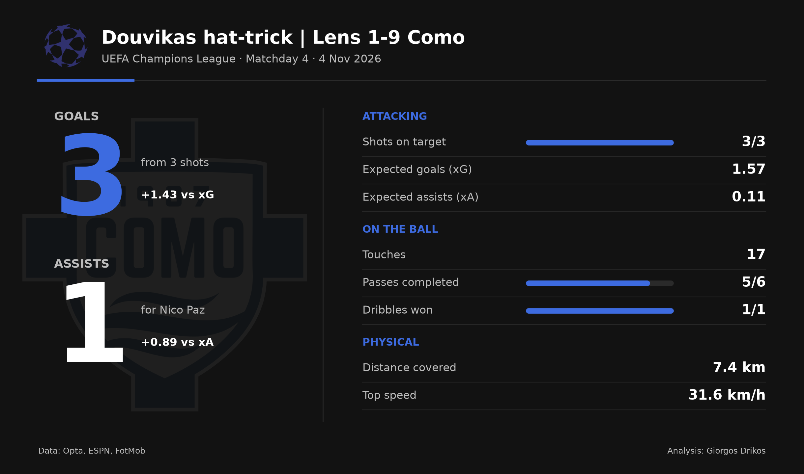
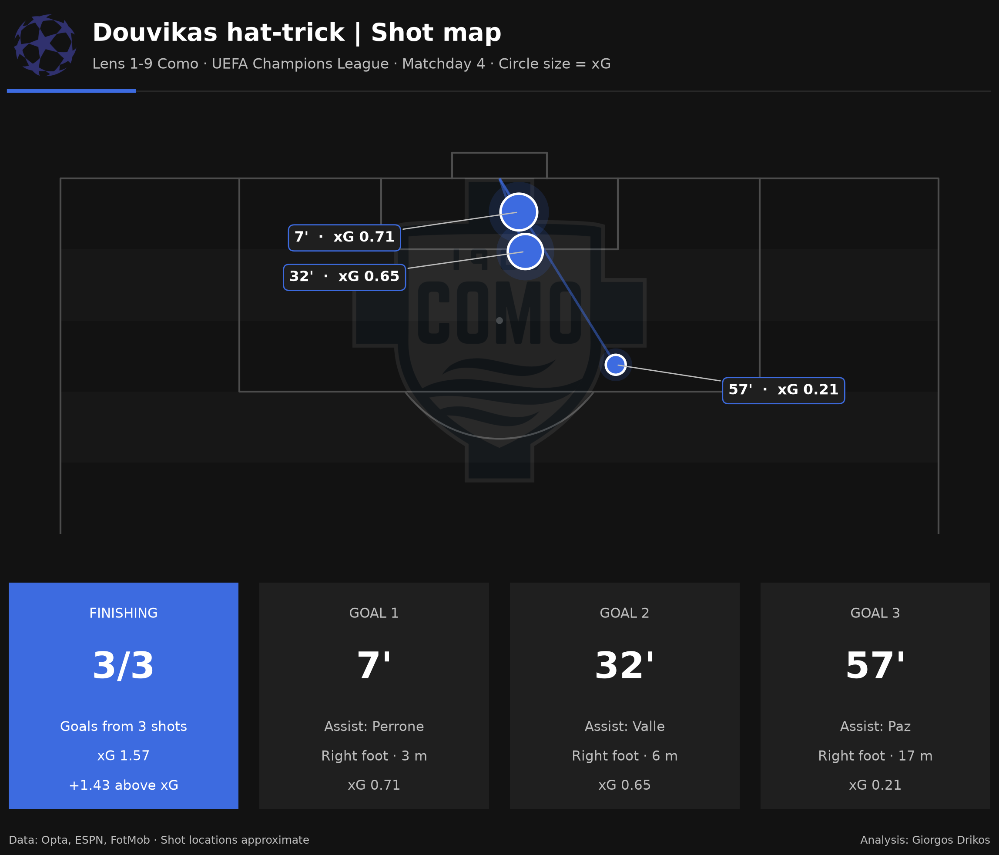
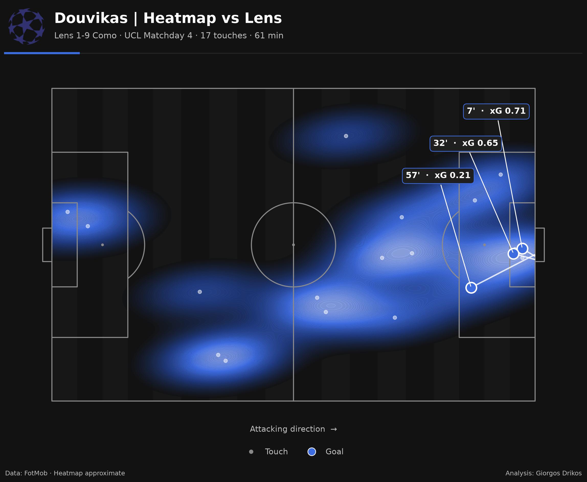
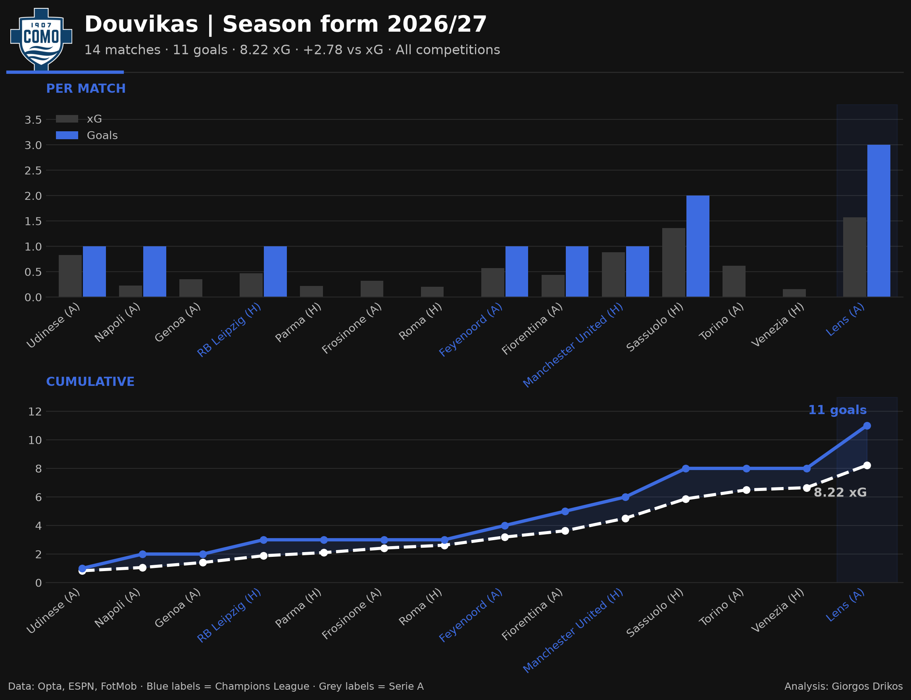
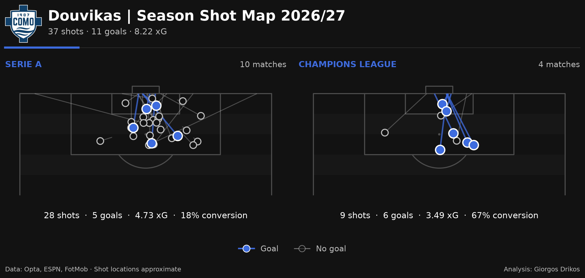

# Douvikas Hat-Trick | Lens 1-9 Como

A football analysis of Anastasios Douvikas' hat-trick against Lens in the UEFA Champions League (Matchday 4, 4 November 2026), and the season behind it. All visuals were built in Python.

## Match overview



Douvikas scored a hat-trick in 61 minutes, converting all three of his shots. His chances were worth 1.57 xG, meaning he finished +1.43 goals above expectation.

## The goals



The first two goals (7', 32') came from close range, the kind of chances a central striker is expected to take (0.71 and 0.65 xG). The third was the standout: a right-footed finish from around 17 metres, worth just 0.21 xG. He also assisted Nico Paz, finishing the night with four goal contributions.

## Movement



His heatmap shows a forward who kept moving rather than waiting in the box, working the right channel and the space in front of the area, and dropping deep to help defend set pieces. With only 17 touches, his impact came from efficiency, not volume.

## Season context





The hat-trick fits a wider trend. Across 14 matches in Serie A and the Champions League, Douvikas has 11 goals from 8.22 xG (+2.78), staying above his expected output all season, with 8 goals in his last 7 appearances. An average of 0.22 xG per shot shows he consistently gets into high-value positions.

## Data and method

- **Sources:** Opta, ESPN, FotMob.
- Match and season data were collected manually and stored as CSV files.
- Shot locations and the heatmap are approximate, reconstructed from FotMob visuals.

## Files

| File | What it does |
|---|---|
| `stats_cards.py` | Match stats graphic |
| `shot_map.py` | Shot map of the three goals |
| `heatmap.py` | Heatmap vs Lens |
| `season_form.py` | Goals vs xG across the season |
| `season_shotmap.py` | All season shots, Serie A and Champions League |
| `*.csv` | The data behind each graphic |

## How to run

```
python3 -m pip install pandas matplotlib mplsoccer seaborn pillow
python3 stats_cards.py
```

Each script reads its CSV file and saves its image in the same folder.

## Tools

Python · pandas · matplotlib · mplsoccer

---

**Giorgos Drikos** · Football Analyst